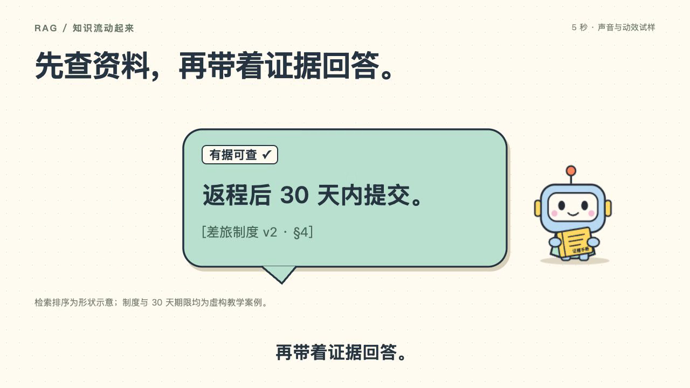

# Cartoon Video Starter · 卡通视频制作模板

一个用 React、SVG 和 Remotion 制作卡通视频的可编辑起点：编排图形变化、字幕和声音，再导出 MP4。适用于知识讲解、产品介绍、流程演示等主题。**RAG 只是仓库内置的五秒教学样例，不是这个项目的使用范围。**

当前版本是代码驱动的视频制作模板，加上可在网页中替换录音的演示播放器；尚不包含拖拽剪辑、多轨时间线或输入文本自动生成完整视频。动画由浏览器逐帧计算后编码，不是逐帧调用视频生成模型。

制作其他主题时：写口播与分镜 → 修改示例组件的文字和 SVG 图形 → 调整关键帧及字幕时间 → 导入录音 → 预览并导出。`src/FiveSecond.tsx` 是可替换的示例场景，`src/config.ts` 定义字幕和声音参数；可新增场景组件并注册为其他 Composition。当前演示仍固定五秒，延长时需同步调整场景、参数校验和配音时间。

**[▶ 在线演示：无需安装，直接观看五秒动画](https://olandooooes.github.io/cartoon-video-starter/)**



[查看五秒无声示例](https://github.com/Olandooooes/cartoon-video-starter/raw/refs/heads/main/examples/demo-silent.mp4)

- 1280 × 720，30 fps，150 帧，5 秒。
- 默认无声；保留字幕，可自行录音或使用有权使用的配音。
- 本项目不调用 TTS 服务，不需要 API Key。依赖安装或首次浏览器准备可能联网。
- 检索条长度是动画示意，不是真实统计数据；制度、版本及“30 天”均为虚构教学案例。

## 安装与预览

安装 Node.js 22.13+（22 系列）或 Node.js 24+；也支持 20.19+（20 系列）。建议使用 Node 24。

```sh
git clone https://github.com/Olandooooes/cartoon-video-starter.git
cd cartoon-video-starter
npm ci
npm run check
npm run dev
```

打开终端显示的 Studio 地址，选择 `RAG-FiveSecond`，按空格播放，拖动时间轴检查动画。首次运行可能准备浏览器。工作目录不要放在需要登录或包含私人资料的公开服务器中。

## 导出

```sh
npm run render
```

生成 `examples/demo-silent.mp4`，覆盖仓库中的无声样片。默认仅两个并发渲染任务。若已有 Chrome，希望避免额外下载，可指定浏览器：

```sh
# macOS 示例；其他系统替换成实际 Chrome 可执行文件路径
npm run render -- --browser-executable="/Applications/Google Chrome.app/Contents/MacOS/Google Chrome"
```

视频编码消耗本机 CPU、内存与时间，不等于语言模型 token 消耗。当前仅渲染 150 帧。修改字体后不同系统的字形和排版可能略有差异。

## 替换配音

推荐先录制两句话：“先查资料。”（约 0.15 秒开始）与“再带着证据回答。”（约 2.2 秒开始），重点之间留停顿。也可用自己有权使用的语音服务生成音频，再离线导入。请先剪辑成约 5 秒的完整时间轴；字幕不会自动识别或对齐。

```sh
npm run voice:import -- --file "/完整路径/我的录音.wav" --license-note "本人录制，允许用于本项目"
npm run render:voice
```

生成 `out/demo-voice.mp4`。支持 wav、mp3、m4a、ogg。重复导入同扩展名会覆盖本地配音。导入程序只复制文件并记录来源说明，不判断其法律授权。

导入后生成 `examples/with-voice.json`。可编辑：

| 参数 | 用途 |
| --- | --- |
| `audioSrc` | `public/` 下的相对路径，如 `audio/voice.wav`；`null` 为无声 |
| `audioOffsetSeconds` | 音频延迟开始的秒数，0 ≤ 值 < 5 |
| `audioVolume` | 音量，0–1 |
| `captions` | 可选；传入完整字幕数组覆盖默认值，`[]` 隐藏字幕 |

参考 `examples/with-voice.example.json`。字幕的 `startSeconds`、`endSeconds` 必须在 0–5 秒内，按时间排列且不重叠。未覆盖字幕时使用 `src/FiveSecond.tsx` 的默认字幕。音频延迟会移动声音，不会自动移动字幕。超过片尾的声音被截断；太短则后段无声。

Studio 带配音预览：

```sh
npm run dev -- --props=examples/with-voice.json
```

导入的音频、授权备注、生成配置及有声导出默认均被 Git 忽略。若要公开配音，先核对实际分发和商用授权，再主动调整忽略规则，并补充素材许可。原先本地 Edge 配音及含该配音的成片未纳入此项目。

## 修改画面

- `src/FiveSecond.tsx`：标题、文案、SVG 形状、颜色与关键帧。
- `src/config.ts`：参数类型与音频、字幕校验。
- `public/robot.svg`：可编辑的卡通机器人。
- `src/index.ts`：注册 Remotion 根组件。
- `scripts/import-voice.mjs`：离线导入配音，无网络请求。

当前关键帧按 30 fps 设计。若修改帧率或时长，需一起调整动画关键帧、字幕和参数校验；仅替换文案或声音不需要改时长。中文字体依次尝试苹方、微软雅黑、Noto Sans CJK SC、系统 sans-serif。本项目不附带系统字体；Linux 如出现方框，请安装 Noto CJK 字体后重启预览。

## 许可与发布边界

本项目自己的代码、机器人 SVG、无声示例及封面按 [MIT](LICENSE) 提供，可修改、再分发、用于商业项目，并保留许可声明。第三方依赖仍受各自条款约束，MIT 不会覆盖它们。

**Remotion 为 source-available，不能把本项目的 MIT 理解为 Remotion 本身也采用 MIT。** 当前固定 4.0.537；其许可对个人、符合条件的小型公司等提供免费使用，其他使用情形可能需要公司许可。使用、升级或商业交付前请核对实际条件，见 [第三方说明](THIRD_PARTY_NOTICES.md)。配音另见 [音频许可说明](AUDIO_LICENSE.md)。

`private: true` 仅用于防止意外发布 npm 包，不影响把源码开源到 Git 仓库。公开修改版本前，请确认新加的图片、字体、音乐、声音和客户资料都有相应授权，并避免提交密钥。

## 本地验收记录

已在 macOS、Node 24 环境完成锁文件安装（`npm ci`）、TypeScript 检查及 3 项导入参数测试；在 Studio 检查布局，并完成无声与替换测试音两条完整导出链路。无声样片实测 5.000 秒、1280×720、30 fps，无音轨；带测试音的 MP4 因 AAC 编码尾帧为约 5.013 秒。测试音和测试成片不随源码分发。其他操作系统尚未实机验证。


## 在线演示与 GitHub Pages

演示页提供播放、暂停、重播、循环播放和 MP4 下载，适配手机；不自动播放、不收集数据，也不依赖在线 TTS 或第三方 CDN。演示使用仓库的五秒无声成片，无需在访客设备上安装 Remotion。

```sh
npm run demo:build
# 使用任意静态服务器预览 dist/；例如已安装 Python 时：
python3 -m http.server 8080 --directory dist --bind 127.0.0.1
```

`docs/index.html` 是页面源文件。构建脚本将页面和示例视频、封面复制到 `dist/`，没有再次渲染视频，也无需安装 npm 依赖。GitHub Pages 使用 `.github/workflows/pages.yml` 部署，在更新页面或样例素材后自动刷新。Fork 后，请在 Settings → Pages 中将 Source 设置为 GitHub Actions，并替换 README 和页面中的原仓库链接。

### 在网页中替换配音

打开在线演示，在“换成你的声音”中选择本地录音，再点击“播放动画”，无需改代码。可调整录音音量和延迟开始时间（0–4.9 秒）；暂停、拖动进度、变速和循环重播时，录音按视频时间重新同步。切换到后台时暂停播放。建议使用约 5 秒的 MP3 或 WAV；支持格式取决于浏览器，文件上限 25 MB、解码时长上限 5 分钟。较短录音播放结束后无声，较长录音在片尾停止。

音频通过浏览器 Web Audio API 在本机解码，不发送到服务器，也不保存到账号或浏览器存储；刷新后需重新选择。此功能只做同步试听，不修改原视频或字幕，下载的仍是无声 MP4。如需导出合成配音的视频，请使用上面的本地渲染教程。
