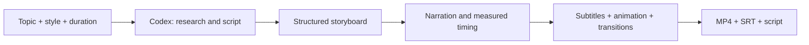

# TopicMotion · Automated Motion Videos

**Give it a topic. Get an animated explainer video.**

English | [简体中文](README.zh-CN.md)

TopicMotion is a **Codex Skill** that turns a topic, visual style and duration into a complete video: script, storyboard, narration, synchronized subtitles, animated scenes and an MP4. It uses shape transformations, flow diagrams and mechanism animations to explain ideas. Cartoon is one of three visual styles—not a restriction on the topic.

[Live demo](https://olandooooes.github.io/TopicMotion/) · [Download Skill](downloads/topicmotion.zip) · [Quick start](#quick-start) · [Contributing](CONTRIBUTING.md)

[](https://olandooooes.github.io/TopicMotion/#intro)

▶ **[Watch the 30-second introduction](https://olandooooes.github.io/TopicMotion/#intro)** · [Download MP4](examples/topicmotion-intro/topicmotion-intro-30s.mp4) · [Subtitles](examples/topicmotion-intro/captions.srt) · [Production sources](examples/topicmotion-intro/README.md)

The introduction currently has **Chinese narration and subtitles**. The documentation is available in English; the validated voice workflow and existing video examples are Chinese.

## Why TopicMotion?

- **A topic-to-video workflow.** Codex researches and writes the content; the local renderer handles narration, timing, subtitles and export. You do not have to write the storyboard JSON for normal Skill use.
- **Motion that explains.** Cards split, sort and merge; diagrams show processes; dedicated fermentation and HTTP-cache scenes illustrate mechanisms.
- **Three visual styles.** Choose cartoon, diagram or editorial while keeping the same structured storyboard.
- **Measured audio timing.** Scenes follow actual utterance lengths, with sentence pauses and captions. Overlong narration raises an error instead of being cut off.
- **Reusable narration.** Successful utterances are cached locally, so a failed render or visual revision can reuse the audio.
- **Inspectable outputs.** Keep the MP4, SRT, script, storyboard, timeline and render report.

RAG is a demonstration topic, not a built-in limit. Additional examples cover bread fermentation and HTTP caching.

## How it works



Content generation uses the model in your current Codex conversation. Rendering uses **React, SVG and Remotion**. No separate content-model API key is required; Codex usage and local rendering still have their own costs.

**The Skill runs inside Codex. The GitHub Pages site is a demo and prompt builder, not a hosted topic-to-video generation service.** The standalone CLI renders an existing storyboard; it does not research or write a new topic on its own.

<a id="安装与第一次使用"></a>

## Quick start

### Requirements

The complete workflow has been validated on **macOS**, with Node.js 24, Python 3, Chrome and Chinese Edge neural TTS. Use Node.js **22.13+**, preferably Node 24. Windows and Linux do not yet have a validated automatic voice adapter.

First use may download npm packages, Python voice dependencies or a browser. Default TTS requires an internet connection and sends the narration text to its provider. It currently requires no API key; a network failure is reported rather than silently switching voices.

### Install the Skill

```sh
git clone https://github.com/Olandooooes/TopicMotion.git
cd TopicMotion
npm ci
npm run skill:install
```

This installs `auto-video` under `${CODEX_HOME:-~/.codex}/skills/`. The installer refuses to overwrite an existing installation. Start a new Codex conversation; restart Codex if the Skill is not listed.

Alternatively, download [topicmotion.zip](downloads/topicmotion.zip), extract it and put the complete `auto-video/` folder in your Codex `skills/` directory. The package excludes dependencies, generated narration and private material. Locked dependencies are prepared on first use.

### Ask Codex to make a video

```text
Use $auto-video to create a 30-second diagram-style explainer about
“Why do we have seasons?” for middle-school students.
Use Chinese narration and subtitles. Research the facts and automatically
produce the script, storyboard, voiceover, animation and final MP4.
```

The validated defaults are Chinese, 30 seconds, cartoon style and landscape 1280×720. **English documentation does not imply that English narration has been validated.** The current built-in default is `zh-CN-XiaoxiaoNeural`; the optional macOS system voice is Tingting.

## Visual styles

| Style | Best suited to | Preview |
| --- | --- | --- |
| `cartoon` | Friendly introductions and science explainers | [View](examples/auto-video/cartoon.png) |
| `diagram` | Technical concepts and processes | [View](examples/auto-video/diagram.png) |
| `editorial` | Ideas, key points and product explanations | [View](examples/auto-video/editorial.png) |

These are programmatic motion graphics. Generative live-action footage, talking avatars and frame-by-frame character animation are not included.

## Render an existing storyboard

To reproduce the bundled 15-second RAG example without generating new content:

```sh
npm run video:example
```

The default output is `out/rag-example/`. Narration synthesis still needs the configured TTS service unless the utterances are already cached. To rerun, choose a new output directory:

```sh
node skills/auto-video/scripts/render.mjs \
  --job skills/auto-video/examples/rag-15s.json \
  --out out/my-rag-run
```

Nonempty output directories are rejected to protect existing files. See the [storyboard format](skills/auto-video/references/job-format.md) (Chinese) for manual customization.

| Output | Contents |
| --- | --- |
| `movie.mp4` | H.264 + AAC, 1280×720, 30 fps |
| `poster.png` | Cover image |
| `script.txt`, `captions.srt` | Narration script and timed captions |
| `input.json`, `timeline.json` | Input storyboard and measured timeline |
| `style-previews/` | Still previews of all three styles |
| `report.json`, `assets/` | Timing/provenance report and locally generated audio |

Supported jobs are **5–180 seconds**, with up to **12 scenes**. Longer content needs to be split into separate jobs. Captions use measured sentence timing, with longer sentences split proportionally by character count; this is not word-level forced alignment.

## Narration and recovery

The default voice is `zh-CN-XiaoxiaoNeural`, at `-12%` speed with a `0.32` second gap between sentences. The first run installs `edge-tts 7.3.1` in a Python virtual environment. Set `AUTO_VIDEO_TTS_PYTHON` to use an existing environment, or explicitly choose `voice.provider=system` for macOS Tingting. Provider availability and terms may change.

Successful utterances are cached in the Skill's `assets/renderer/.voice-cache/`. Use `--cache` to choose another private directory. Cache entries contain narration text and audio; keep them local and do not commit them.

If a run fails, retain its cache and retry into a **new output directory**:

```sh
node skills/auto-video/scripts/render.mjs \
  --job skills/auto-video/examples/bread-15s.json \
  --out out/bread-retry \
  --cache /tmp/my-private-video-cache
```

Use the same cache path on both runs, or omit `--cache` on both to use the default. Changes to text or voice settings invalidate the affected utterances; visual changes can reuse them. Corrupt entries regenerate. When every utterance is cached, Python and the TTS service are not invoked. `report.json.cache` records hits and newly synthesized entries.

Only narration is reused—the animation is rendered again in full. This is not frame-level render resumption.

## Demo and examples

The [live demo](https://olandooooes.github.io/TopicMotion/) includes:

- The **30-second voiced introduction**, with Chinese narration and subtitles.
- A **60-second RAG explainer** and **15-second fermentation / HTTP-cache examples**. These older public examples are silent; their original voice tracks are not redistributed.
- Three style previews, a Skill download and a prompt builder.
- The original five-second animation, with an option to preview your own recording in sync.

The recording preview reads a local file in your browser. It does not upload or store it, generate a new MP4 or change the downloaded silent example. Choose the file again after refreshing.

To serve the demo locally:

```sh
npm run demo:build
python3 -m http.server 8080 --directory dist --bind 127.0.0.1
```

The Pages workflow deploys the static site, public examples and Skill downloads. For a fork, select **Settings → Pages → GitHub Actions** and update repository links. The site has no third-party CDN, online TTS or analytics script. The interface defaults to English and can switch to Chinese; the choice is remembered locally. Use `?lang=en` or `?lang=zh` for an explicit language link. Existing videos retain their Chinese narration and subtitles.

## Development

```sh
npm run check      # Project/renderer type checks and behavior tests
npm run skill:pack # Reproducible ZIPs and SHA256SUMS; Python standard library
npm run dev        # Remotion Studio for the original five-second animation
```

| Path | Purpose |
| --- | --- |
| `skills/auto-video/` | Independently installable Skill and renderer |
| `src/TopicMotionIntro.tsx` | Dedicated project introduction |
| `src/FiveSecond.tsx` | Original five-second example |
| `docs/`, `scripts/build-demo.mjs` | Static demo website |
| `examples/auto-video/` | Public silent videos and style previews |
| `examples/topicmotion-intro/` | Voiced introduction, source records and reproduction instructions |

Default neural TTS needs Python 3; the explicit macOS system voice does not. PyYAML is only needed for the optional Skill-maintenance validator. See [CONTRIBUTING.md](CONTRIBUTING.md) before submitting changes.

## License and provenance

Original code and self-created SVG artwork are provided under [MIT](LICENSE). Third-party dependencies keep their own licenses. **Remotion is source-available under its own license**; this project's MIT license does not relicense Remotion.

The 30-second public introduction uses the standard `zf_001` voice from the Apache-2.0 **Kokoro Chinese model**, pinned to a recorded revision. Model weights are not included. Its [source records](examples/topicmotion-intro/voice-source.json) and [reproduction instructions](examples/topicmotion-intro/README.md) document the voice. The default Skill's Edge/macOS output is not automatically authorized for public redistribution or commercial use by this repository's license.

Consult the [third-party notices](THIRD_PARTY_NOTICES.md), [sources](SOURCES.md) and [audio notes](AUDIO_LICENSE.md) (currently Chinese) before distributing generated media. Use your own recording or another appropriately licensed voice when needed.

RAG examples paraphrase public research. Illustrative ranking bars are not measured statistics; policies and “30 days” in the earliest example are fictional teaching material. Generated explanations still need factual review. [Delivery](DELIVERY.md) and [review](REVIEW.md) records document validation and current boundaries in Chinese.

## Naming and compatibility

The project was renamed from `cartoon-video-starter` to **TopicMotion** to emphasize automated production and motion graphics. Use the [current repository](https://github.com/Olandooooes/TopicMotion) and [demo](https://olandooooes.github.io/TopicMotion/). Old GitHub repository and Git URLs retain GitHub redirects; old Pages entry points use a compatibility redirect. Do not recreate a repository under the old name if you want those GitHub redirects to remain intact.

The Skill invocation remains **`$auto-video`**, and the installation folder remains **`auto-video/`**. `topicmotion.zip` and the legacy `auto-video.zip` contain the same package. Existing script paths and historical videos are retained; older exported videos may show the previous branding.

To upgrade, first back up your existing Skill **outside** the Codex `skills/` directory, review the new package and merge personal changes. The installer will not overwrite it. Renaming the repository does not automatically upgrade a local Skill. Never publish private narration caches as part of a backup or contribution.
