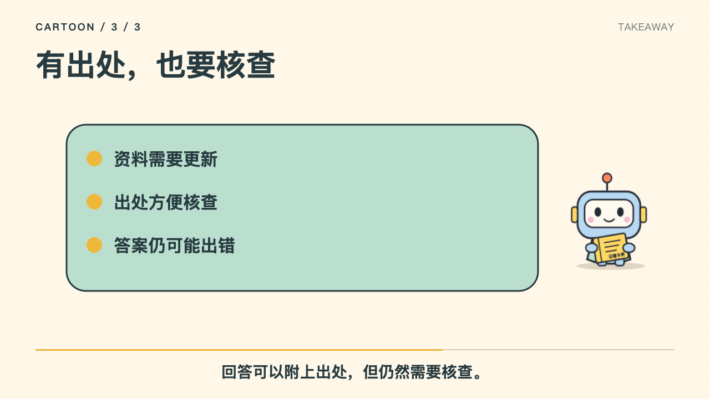

# TopicMotion · 自动制作动效视频

[English](README.md) | 简体中文

**说一个话题，自动做成动效视频。**

在 Codex 里给出话题、风格和时长，TopicMotion 自动完成讲稿、分镜、自然中文配音、同步字幕与 MP4 渲染。用图形变换、流程演示和机制动画表达内容；卡通只是可选形式之一。无需另配内容模型 API。

[在线演示](https://olandooooes.github.io/TopicMotion/) · [下载 TopicMotion Skill](downloads/topicmotion.zip) · [Skill 指令](skills/auto-video/SKILL.md) · [验证与交付记录](DELIVERY.md) · [独立评审记录](REVIEW.md)

[](https://olandooooes.github.io/TopicMotion/#intro)

▶ **[播放 30 秒有声项目介绍](https://olandooooes.github.io/TopicMotion/#intro)** · [下载 MP4](examples/topicmotion-intro/topicmotion-intro-30s.mp4) · [同步字幕](examples/topicmotion-intro/captions.srt) · [分镜与配音来源](examples/topicmotion-intro/README.md)

> 用 `$auto-video` 把 RAG 做成 60 秒卡通讲解视频，全自动生成口播、字幕和成片。



[观看一分钟丰富动效样片](examples/auto-video/rag-60s-silent.mp4)。本地已验证有声成片；公开版不附带尚未确认再分发授权的合成配音。RAG 是验证话题，工具不限于 RAG 或卡通。

## 它怎样工作


内容生成使用当前 Codex 对话模型，渲染器使用 React、SVG 和 Remotion。**Skill 在 Codex 中运行；GitHub Pages 是演示页，不是任意话题生成后端。** 无需额外模型 API，不代表没有 Codex 用量或本机渲染成本。

## 安装与第一次使用

已验证环境：macOS、Node.js 24、Python 3、Chrome、Edge 中文神经配音（显式选择系统音时为 Tingting）。需要 Node.js 22.13+；建议 Node 24。首次运行可能下载 npm 依赖、Python 配音依赖或浏览器。默认在线神经配音不需 API 密钥，但会发送口播文本；网络失败会明确报错，不静默切换声音。当前其他系统尚未实现自动配音适配器。

```sh
git clone https://github.com/Olandooooes/TopicMotion.git
cd TopicMotion
npm ci
npm run skill:install
```

安装到 `${CODEX_HOME:-~/.codex}/skills/auto-video`。已有同名 Skill 时会停止，避免覆盖个人修改。在新 Codex 对话中调用；若列表未更新，重启 Codex。

无需整仓库安装：下载 [auto-video.zip](downloads/auto-video.zip)，解压后将完整的 `auto-video/` 放进 Codex 的 `skills/` 目录。压缩包不含 node_modules、生成的配音或秘密信息，首次调用自动准备已锁定依赖。

然后直接说：

```text
用 $auto-video 把“为什么会有四季”做成 30 秒流程图风格视频。
面向初中生，自动完成资料核验、讲稿、分镜、配音和成片。
```

不用自己写 JSON，也不用逐步批准每个制作环节。默认中文、30 秒、横屏 720p；话题、时长和风格以用户要求为准。

## 可选风格

| 风格 | 适合表达 | 预览 |
| --- | --- | --- |
| `cartoon` 卡通 | 科普、入门讲解 | [查看](examples/auto-video/cartoon.png) |
| `diagram` 蓝色流程图 | 技术原理、流程 | [查看](examples/auto-video/diagram.png) |
| `editorial` 极简图文 | 观点、要点、产品说明 | [查看](examples/auto-video/editorial.png) |

这三个版本使用同一分镜，改变视觉呈现。当前为程序化图形动画，不包含生成式实拍、数字人或逐帧角色表演。

## 无需调用模型的复现命令

已经生成的 [RAG 分镜](skills/auto-video/examples/rag-15s.json) 可直接复现“分镜到成片”：

```sh
npm run video:example
```

默认输出 `out/rag-example/`，非空目录会拒绝写入。重复验证请换一个新目录：

```sh
node skills/auto-video/scripts/render.mjs \
  --job skills/auto-video/examples/rag-15s.json \
  --out out/my-rag-run
```

| 输出 | 内容 |
| --- | --- |
| `movie.mp4` | H.264 + AAC，1280×720，30 fps |
| `poster.png` | 封面 |
| `script.txt`、`captions.srt` | 口播稿和同步字幕 |
| `input.json`、`timeline.json` | 输入分镜与测时后的时间线 |
| `style-previews/` | 三种风格的静帧 |
| `report.json`、`assets/` | 时长与来源记录、本地合成音轨 |

程序逐句合成语音，测量实际音频长度，调整语速与场景时间。口播过长会明确报错，Skill 应压缩文案后重试；不截断句子假装完成。当前支持 5–180 秒和最多 12 个场景，长内容需要分段制作。

**命令行渲染器不会自己凭空生成新话题内容。** 新话题的编稿和事实核验由使用 Skill 的 Codex 完成。结构化格式见 [job-format.md](skills/auto-video/references/job-format.md)。

## 在线演示与录音试听

[演示页](https://olandooooes.github.io/TopicMotion/) 包含完整 60 秒连续动效样片、15 秒早期样片、三种风格静帧、Skill 下载和指令生成入口，保留最早五秒形状变换试样。

在五秒播放器下选择自己的录音，即可同步试听、调音量与延迟；录音仅在本浏览器读取，不上传、不保存。刷新后需重选。此处不合成新 MP4，下载的仍是无声视频。

```sh
npm run demo:build
python3 -m http.server 8080 --directory dist --bind 127.0.0.1
```

Pages 工作流自动部署页面、公开示例和 Skill 下载。Fork 后启用 Settings → Pages → GitHub Actions，并替换仓库链接。页面没有第三方 CDN、在线 TTS 或分析脚本。

## 开发与验证

```sh
npm run check       # 主项目与独立渲染器类型检查、行为测试
npm run skill:pack # Python 3 标准库，生成可复现 ZIP 和 SHA256SUMS
npm run dev        # 最初五秒动画的 Remotion Studio
```

- `skills/auto-video/`：可独立安装的 Skill 和渲染器。
- `src/FiveSecond.tsx`：保留的最初五秒样片。
- `docs/`、`scripts/build-demo.mjs`：静态演示页。
- `examples/auto-video/`：公开的无声成片和风格预览。

默认 neural 配音需要 Python 3；显式 system 配音无需 Python。PyYAML 只用于维护校验，不是运行依赖。官方 Skill 校验器属于维护工具，可在具备 PyYAML 的环境使用。

## 来源、许可和限制

原创代码、机器人 SVG、公开无声视频与静帧采用 [MIT](LICENSE)。Remotion 是 source-available，依其自身许可，不能把本仓库 MIT 解释为对 Remotion 的重新授权。详见 [第三方说明](THIRD_PARTY_NOTICES.md)、[素材来源](SOURCES.md) 和 [配音说明](AUDIO_LICENSE.md)。

RAG 事实来自公开论文的通俗改写。图中排序条不代表实测统计，最初样例中的制度和“30 天”是虚构教学案例。输出质量仍依赖资料、脚本和所用语音，自动生成不等于事实保证。

当前待用户决定的事项记录在 [DELIVERY.md](DELIVERY.md)：包括未来公开配音的授权来源，以及是否投入云端生成后端。它们不影响现有本地 Skill、公开无声演示和复现流程。

## v0.3：自然配音与丰富动效

默认中文神经配音慢 12%，句间停顿 0.32 秒，按实际音长分配场景。文案过长会要求缩短，不加速或切断口播。字幕为句级测时和字数分段估计。首次自动安装 edge-tts 7.3.1；可用 `AUTO_VIDEO_TTS_PYTHON` 指定已有环境。在线服务可用性与许可由其提供方决定，不能保证永久免密钥可用。

六种动效支持卡片拆分归档、排序筛选、输入汇聚、资料变回答、引用出现与总结聚合；全部按场景时长缩放。三种风格共享动效，切换配色。换话题时由 Codex 重写分镜字段，程序不含固定 RAG 文案。可复现分镜见 [一分钟任务](skills/auto-video/examples/rag-60s.json)。本地另用“面包为什么会发起来”验证相同流程。

## v0.4：画面解释机制，失败后复用配音

新增面团发酵与HTTP缓存两种解释型动画，分别表现内部气泡膨胀和命中/回源分支；它们不是相同卡片换文字。示例分镜：[发酵](skills/auto-video/examples/bread-15s.json)、[HTTP缓存](skills/auto-video/examples/http-cache-15s.json)。普通话题仍可使用原六种通用动效。

默认缓存成功的每句声音到 Skill `assets/renderer/.voice-cache/`，可用 `--cache /私密目录` 指定位置。缓存包含原文和音频，保持本地；默认目录不进Git、安装包或ZIP。文本或声音设置改变会生成新声音，只改风格或总时长可复用。损坏项不会命中，全部命中时不启动Python或联系TTS。

失败后无需删除原文件，使用新输出目录重试：

```sh
node skills/auto-video/scripts/render.mjs \
  --job skills/auto-video/examples/bread-15s.json \
  --out out/bread-retry \
  --cache /tmp/my-private-video-cache
```

必须沿用失败任务的缓存路径；首次也应传同一个 `--cache`，或两次都不传以使用默认位置。只复用配音，动画仍完整渲染；不是从某一视频帧继续。非空输出目录继续拒绝覆盖。`report.json.cache` 显示命中与新生成数。需清理时，只删除自己确认的缓存目录，下次会重新生成声音。

## 名称迁移与兼容

项目已从 `cartoon-video-starter` 更名为 **TopicMotion**，强调自动制作与动效表达。新仓库：`Olandooooes/TopicMotion`；演示：<https://olandooooes.github.io/TopicMotion/>。GitHub 旧仓库网页与Git操作保留平台重定向；不要重新创建同名旧仓库。旧Pages入口由账号站点兼容页跳转，新链接应优先使用上面的地址。

Skill显示名称改为TopicMotion，调用仍为 `$auto-video`，安装目录 `skills/auto-video` 不变，避免破坏既有工作流。新下载名 `topicmotion.zip` 与旧 `auto-video.zip` 为完全相同的安装包，内部仍是 `auto-video/`。旧脚本路径、公开样片路径和本地工程目录保留。历史导出样片中的旧片头不重编码；新生成视频使用TopicMotion片头。

已有用户升级：先审阅并将原 `auto-video` Skill 备份到 `skills/` 目录之外，再安装新包；将个人改动逐项合并，不直接覆盖或公开私密缓存。原有安装不会仅因仓库改名自动升级。本机此次安装版已由维护者核验备份后同步，其他用户请自行执行上述升级步骤。
